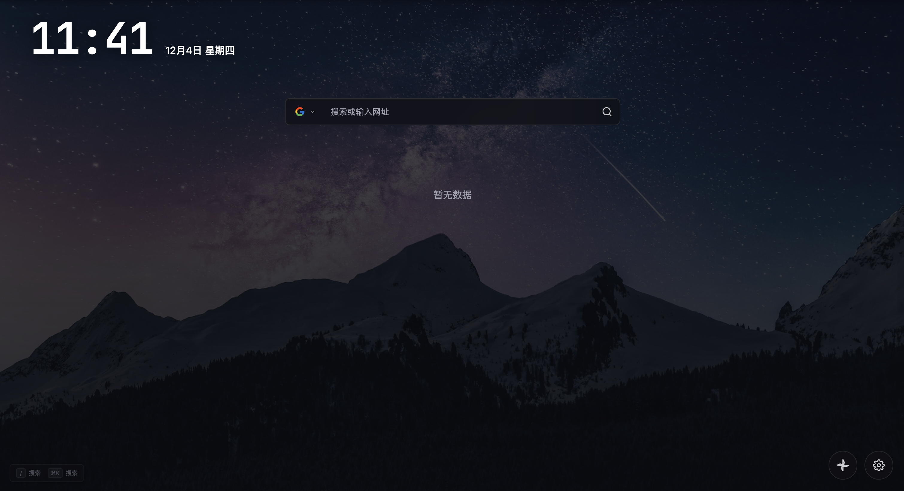
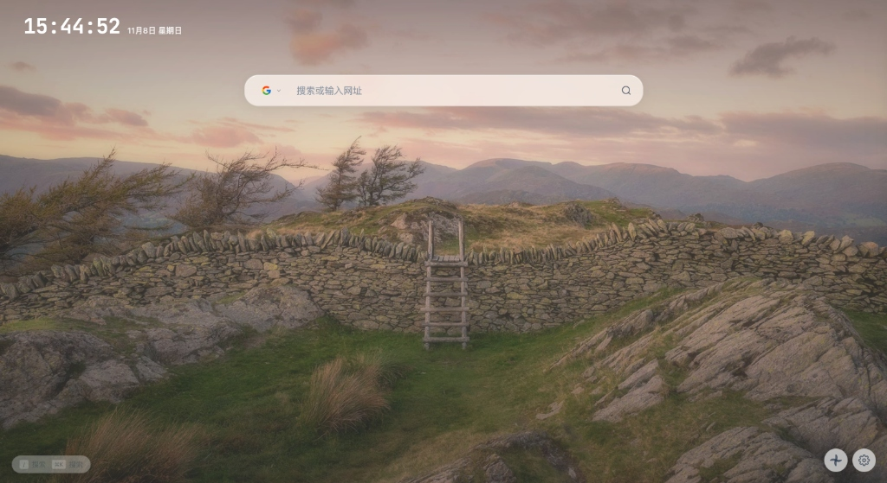

<div align="center">

# TabZero

**✨ Ultra-minimalist, aesthetic, privacy-first modern browser new tab extension**

[English](README.md) | [简体中文](README_zh.md)

<p align="center">
  <a href="https://opensource.org/licenses/MIT"></a>
  <a href="https://react.dev/"></a>
  <a href="https://www.typescriptlang.org/"></a>
  <a href="https://vitejs.dev/"></a>
  <a href="https://developer.mozilla.org/en-US/docs/Web/API/SubtleCrypto"></a>
  <a href="https://developer.chrome.com/docs/extensions/mv3/intro/"></a>
  
</p>

</div>

---

### Preview

<p align="center">
  
</p>

<p align="center">
  
</p>

---

### ✨ Key Features

- **🎯 Ultra Minimalist Aesthetics**
  - Modern typography powered by *Outfit* and *JetBrains Mono*, with comfortable 64px golden hero spacing.
  - Built-in dynamic readability shields and subtle vignette shading, ensuring crystalline text legibility across both vibrant light and deep dark wallpapers.
- **🔒 WebDAV Cloud Sync (Zero-Knowledge AES-256-GCM Encryption)**
  - Seamlessly syncs with any standard WebDAV cloud (Nextcloud, Synology NAS, Alist, etc.).
  - **Zero-knowledge privacy**: All bookmarks and categories are encrypted client-side using browser-native Web Crypto API with PBKDF2 (100,000 iterations) derived keys and AES-256-GCM authenticated encryption. Your server only stores encrypted ciphertext.
  - Active connection monitoring with an animated pulsing breathing light (🟢 Connected / 🔴 Disconnected).
- **🖼️ Microsoft Official CDN Wallpaper Stream (120+ Curated Unique Wallpapers & Fisher-Yates Shuffle)**
  - **120 Curated Distinct Wallpapers**: Curated from Bing's finest landscape and cultural photography, strictly deduplicated by image subject, connected directly to Microsoft's official CDN (`cn.bing.com`) for millisecond delivery.
  - **Fisher-Yates Shuffle Playlist**: Replaces pseudo-random sampling with a true randomized playlist queue. **Guarantees 100% zero repetitions for 120 consecutive clicks**!
  - **Living Water Auto-Discovery**: Probes Microsoft's daily feed in the background upon switching; whenever Microsoft publishes today's brand-new daily wallpaper, it seamlessly injects into your rotation queue.
  - **Zero-Watermark Offline Fallback**: Bundles pristine 1080P default wallpapers (Dark: Iceland Aurora; Light: Alpine Dolomites lake). Chrome disk cache preserves viewed wallpapers offline without ever flashing back to default.
- **📑 Integrated Bookmark & Category Manager**
  - Streamlined unified "Bookmark Management" drawer with single-page vertical scrolling layout.
  - **Inline Breathing Line Category Rename**: Click any category to rename in-place with an animated glowing underline; press Enter or blur to save with zero clutter.
  - **Row-Click Bookmark Editing**: Filter bookmarks by category dropdown; click anywhere on a bookmark row to launch the edit modal without ugly extra buttons.
- **📂 Native Browser Bookmark Import & Export**
  - **Lossless HTML Parsing**: Seamlessly import standard Netscape bookmark HTML files exported from Chrome, Edge, Safari, and Firefox, preserving folder hierarchies and favicon associations.
  - **Offline JSON Backup**: One-click structured JSON export and import for full offline data sovereignty.
- **🔍 Multi-Search Engine Instant Switching**
  - Pre-configured with 25+ mainstream search engines (Google, Bing, Baidu, GitHub, DuckDuckGo, Zhihu, Bilibili, Taobao, MDN, etc.).
  - **Full Keyboard Cycling**: Press `Tab` or `Shift + Tab` to seamlessly cycle through search engines without touching the mouse.
  - **Direct Prefix Triggers**: Type `b + Space` for Bing, `g + Space` for Google, `gh + Space` for GitHub directly in the search bar.
- **⌨️ Keyboard-First Workflow**
  - `⌘K` / `Ctrl + K`: Summon global quick search overlay anywhere.
  - `/` or `、`: Instantly focus the main search bar (fully IME-friendly).
  - `Esc`: Dismiss any drawer, modal, or overlay instantly.
- **⚙️ Layered System Preferences**
  - **Dark Mode**: Dark mode toggle and quick navbar switch button.
  - **Display**: Clock, quick link tiles, and bookmark bar visibility controls.
  - **Time Module**: Show seconds, clock color personalization.
  - **General**: Multi-language selection and default link open mode (new tab `_blank` vs current tab `_self`).

---

### 🖼️ Wallpaper Architecture & Fisher-Yates Playlist Algorithm

To solve repetitive wallpaper cycling and slow loading times, TabZero employs a lightweight **Dual-Track Living Water Engine**:

```
                    ┌──────────────────────────────────────────────┐
                    │  120 Deduplicated Curated HD Wallpapers Base  │
                    └──────────────────────┬───────────────────────┘
                                           │  Fisher-Yates Shuffle
                                           ▼
【Click Wallpaper Button】◄──► 【 Active Randomized Playlist (~15KB) 】
                                           ▲
                                           │  Daily Silent Probing
                    ┌──────────────────────┴───────────────────────┐
                    │ Microsoft Official Daily Feed (Fast CDN)     │
                    └──────────────────────────────────────────────┘
```

1. **Strict Image Deduplication**: Strips identical images published across international Bing markets with varying suffix codes (e.g., `_ZH-CN` vs `_EN-US`), ensuring 120 truly distinct artworks.
2. **Fisher-Yates Shuffle Playlist**: Shuffles the pool into a linear queue where an internal pointer advances on each click. Mathematically guarantees 0 repetitions for 120 consecutive clicks until the full deck has been viewed.
3. **Daily Living Water Auto-Injection**: Silently queries Bing's today feed in the background. Freshly released daily wallpapers are seamlessly spliced into the queue without interruption.
4. **Zero-Bloat Storage**: The extension package stores only tiny text URLs (~15 KB). High-resolution images stream directly from Microsoft CDN and are cached by Chrome's native disk cache for offline persistence.

---

### 📂 Directory Structure

```text
TabZero/
├── TabZero/                  # Production-ready Chrome Extension distribution (v4.3)
│   ├── manifest.json         # Extension Manifest V3 configuration
│   ├── index.html            # New tab page entrypoint
│   ├── assets/               # Production runtime (~590 KB total)
│   │   ├── main.js           # Bundle (React 19 + Shuffle Engine + WebDAV AES-256)
│   │   └── style.css         # Styles (glassmorphism, breathing light, responsive layout)
│   ├── icons/                # High-res SVG and PNG extension icons
│   │   ├── icon.svg          # Master vector logo
│   │   ├── icon16.png / 48 / 128
│   │   └── engines/          # Vector icons for 25+ search engines
│   ├── wallpapers/           # 1080P zero-watermark offline default wallpapers
│   └── screenshots/          # 4K demonstration previews
├── public/                   # Static assets
├── src/                      # Modern TypeScript + React 19 source code
│   ├── components/           # UI modular components
│   ├── hooks/                # Custom React Hooks
│   ├── i18n/                 # Localization (zh-CN, en-US)
│   ├── stores/               # Zustand state stores
│   ├── types/                # TypeScript type definitions
│   └── utils/                # AES-256, WebDAV, Shuffle algorithm, Bookmark parser
├── package.json              # Package manifest and build scripts
├── vite.config.ts            # Vite 7 build configuration
└── README.md                 # English documentation
```

---

### 🚀 Installation & Usage

#### Method 1: Load Unpacked Directory (Recommended)

1. Clone or download this repository:
   ```bash
   git clone git@github.com:oceanxux/TabZero.git
   ```
2. Open Chrome or Edge and navigate to `chrome://extensions/`;
3. Enable **"Developer mode"** in the top right corner;
4. Click **"Load unpacked"** in the top left corner;
5. Select the **`TabZero`** folder in the root of the repository!

#### Method 2: Packaged Extensions (CRX / ZIP)

Pre-built standard packages are available in the repository root:
- **`TabZero-v4.3.crx`** (~2.0 MB, drag and drop into browser)
- **`TabZero-v4.3.zip`** (~2.0 MB, standard Chrome Web Store package)

---

### ⌨️ Keyboard Shortcuts Reference

| Shortcut | Action | Context |
| :--- | :--- | :--- |
| **`/`** or **`、`** | **Focus Search Bar** (IME-friendly) | Ready to type search query anywhere |
| **`⌘ + K`** or **`Ctrl + K`** | **Open Global Quick Search** | Summon search overlay at any moment |
| **`Tab`** / **`Shift + Tab`** | **Cycle Search Engines** | Swiftly switch search engines via keyboard |
| **`b `** / **`g `** + Space | **Direct Engine Prefix** | Type `b query` for Bing, `g query` for Google |
| **`Esc`** | **Dismiss / Close** | Close drawers, modals, or search overlays |

---

### 🛡️ Security & Zero-Knowledge Architecture

TabZero strictly adheres to client-side zero-knowledge encryption:

```
[ User Bookmarks & Categories ]
              │
              ▼
[ Native Web Crypto API Sandbox ]
  ├── Derived Key: PBKDF2 (100,000 SHA-256 iterations)
  ├── Random Cryptographic Salt (16 bytes) + IV (12 bytes)
  └── Authenticated Encryption: AES-256-GCM
              │
              ▼
[ Encrypted Ciphertext Package ]
              │
              ▼  (Encrypted HTTPS transmission)
[ Your Private WebDAV Server (Nextcloud / Synology / NAS) ]
```

---

### 📄 License

This project is licensed under the [MIT License](LICENSE).

<div align="center">

**Crafted with care for a cleaner, faster web browsing experience.**

</div>
