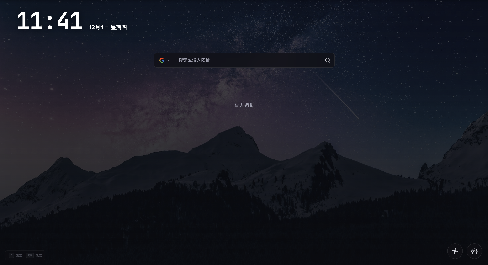
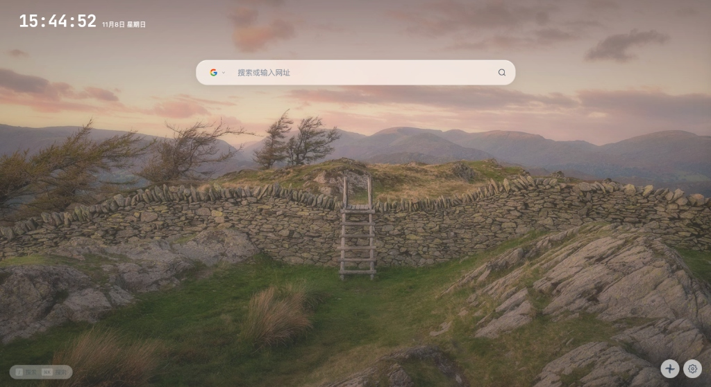

<div align="center">

# TabZero

**✨ 极简高效、颜值至上的现代化浏览器新标签页扩展**

[English](README.md) | [简体中文](README_zh.md)

<p align="center">
  <a href="https://opensource.org/licenses/MIT"></a>
  <a href="https://react.dev/"></a>
  <a href="https://www.typescriptlang.org/"></a>
  <a href="https://vitejs.dev/"></a>
  <a href="https://developer.mozilla.org/en-US/docs/Web/API/SubtleCrypto"></a>
  <a href="https://developer.chrome.com/docs/extensions/mv3/intro/"></a>
</p>

</div>

---

### 预览

<p align="center">
  
</p>

<p align="center">
  
</p>

---

### ✨ 核心亮点

- **🎯 极致极简视觉设计**
  - 现代视觉排版，采用 *Outfit* 与 *JetBrains Mono* 字体，辅以 64px 舒适留白间距，视觉焦点更通透自然。
  - 内置自适应视觉护盾与暗角阴影，确保在任何复杂浅色或深色壁纸下文字均清晰易读。
- **🔒 WebDAV 云端同步 (AES-256-GCM 端到端强加密)**
  - 支持任意标准 WebDAV 服务（Nextcloud、群晖 NAS、Alist 等私有云及商业云存储）。
  - **真正的零知识隐私**：所有书签与分类在本地浏览器内调用原生 Web Crypto API，通过用户设置的密码派生密钥（PBKDF2 10万次哈希），进行 AES-256-GCM 强加密后传输，服务器端仅存储密文。
- **🟢 智能同步探活与呼吸灯状态**
  - 设置面板提供一键「🔍 测试连接」，配备动态呼吸指示灯（🟢 绿色已连接 / 🔴 红色未连接），连接健康状态一目了然。
  - 遇到路径或权限异常时，提供透明友好的排查指引（如 401 凭证错误、403 权限受限、404 路径不存在等）。
- **📂 本地数据双轨导入与导出**
  - **浏览器原生 HTML 书签无缝解析导入**：完美兼容 Chrome / Edge / Safari / Firefox 导出的标准 Netscape 格式书签 HTML 文件，自动提取文件夹树、分类及 Favicon 图标。
  - **离线 JSON 备份与导出**：一键导出结构化 JSON 备份文件，纯本地操作，自主可控。
- **🔍 多搜索引擎一键快捷切换**
  - 预置并支持 25+ 主流引擎（Google、Bing、Baidu、GitHub、DuckDuckGo、知乎、Bilibili、淘宝、MDN 等）。
  - **全键盘轮巡**：按 `Tab` / `Shift + Tab` 顺次快速轮巡切换当前搜索引擎。
  - **前缀快捷直达**：在搜索框输入 `b + 空格` 瞬切 Bing，`g + 空格` 瞬切 Google，直观快捷。
- **⌨️ 全局沉浸式键盘快捷键**
  - `⌘K` / `Ctrl + K`：无论焦点何处，随时唤起全局快速搜索遮罩。
  - 单键 `/` 或中文标点 `、`：一键自动聚焦新标签页主搜索框，提笔即搜。
  - `Esc`：快速关闭所有侧边抽屉与弹出层。
- **🖼️ 微软官方国内 CDN 4K 每日壁纸流**
  - 剔除海外第三方反代中转，直连微软国内官方 CDN（`cn.bing.com`），毫秒级极速下发。
  - **滚动单张本地缓存机制**：本地永远只保存当前使用的一张壁纸，浏览器磁盘原生强缓存秒开，切换下一张时自动替换，永不膨胀。
- **⚙️ 贴心细节偏好定制**
  - 支持书签默认打开方式自由切换（新标签页 `_blank` / 当前标签页 `_self`）。
  - 系统设置独立收纳：时钟、快捷访问磁贴、书签栏、主题切换按钮皆可按需自由显隐。

---

### 📂 目录结构树

```text
TabZero/
├── TabZero/                  # Chrome 扩展生产分发目录 (可直接加载或打包发布)
│   ├── manifest.json         # Chrome 扩展核心清单文件 (Manifest V3)
│   ├── index.html            # 扩展新标签页挂载入口
│   ├── assets/               # 生产核心运行时 (纯净体积仅 ~590KB)
│   │   ├── main.js           # 业务逻辑 bundle (React 19 + Zustand + WebDAV + WebCrypto)
│   │   └── style.css         # 样式与动画定义 (毛玻璃效果、响应式栅格、呼吸灯等)
│   ├── icons/                # 扩展图标与内置 25+ 搜索引擎高清矢量 SVG
│   │   ├── icon.svg          # 官方主 Logo 矢量源文件
│   │   ├── icon16.png / 48 / 128
│   │   └── engines/          # 各大搜索引擎专用品牌图标 (Google, Bing, GitHub 等)
│   └── screenshots/          # 4K 高清演示预览截图
├── public/                   # 公共静态资产目录
├── src/                      # 现代化开发源码 (TypeScript + React 19)
│   ├── components/           # UI 模块化组件
│   │   ├── Bookmarks/        # 书签列表、文件夹树、拖拽排序
│   │   ├── Clock/            # 极简时钟与日期显示
│   │   ├── QuickLinks/       # 快捷磁贴面板与编辑对话框
│   │   ├── SearchBar/        # 搜索输入框、前缀匹配、引擎快捷轮巡
│   │   ├── SettingsDrawer/   # 侧边设置抽屉 (同步、外观、书签与系统偏好)
│   │   └── ui/               # 基础设计系统原子组件 (Button, Input, Select, Modal)
│   ├── hooks/                # 自定义 React Hooks (键盘事件监听、拖拽排序等)
│   ├── i18n/                 # 国际化语言包 (zh-CN, en-US)
│   ├── stores/               # Zustand 全局响应式状态总线
│   ├── types/                # 严谨的 TypeScript 类型契约
│   └── utils/                # 核心工具库 (AES-256 加密、WebDAV 通信、HTML 书签解析)
├── package.json              # 项目依赖清单与构建指令
├── vite.config.ts            # Vite 7 极速现代化构建配置
└── README.md                 # 项目完整设计文档与使用指南
```

---

### 🚀 安装与使用

#### 方式一：直接载入生产目录（最简单，推荐）

1. 下载或克隆本项目：
   ```bash
   git clone git@github.com:oceanxux/TabZero.git
   ```
2. 打开 Google Chrome 或 Edge 浏览器，访问扩展管理页面：`chrome://extensions/`；
3. 打开右上角的 **「开发者模式」** (Developer Mode)；
4. 点击左上角的 **「加载已解压的扩展程序」** (Load Unpacked)；
5. 在文件选择窗口中选中本项目根目录下的 **`TabZero`** 文件夹即可！

#### 方式二：使用官方打包扩展（CRX / ZIP）

项目已在发布目录中为您预打包了两种标准扩展包：
- **`TabZero-v1.0.3.crx`**（仅 163 KB，支持拖入浏览器直接安装）
- **`TabZero-v1.0.3.zip`**（仅 160 KB，标准 Chrome Web Store / Edge 商店上架包）

#### 方式三：从源码二次构建

```bash
# 1. 进入项目根目录并安装依赖
npm install

# 2. 启动本地热重载开发服务器
npm run dev

# 3. 编译打包生成生产版本
npm run build
```

---

### ⌨️ 快捷键速查表

| 按键 | 功能说明 | 适用场景 |
| :--- | :--- | :--- |
| **`/`** 或 **`、`** | **聚焦搜索框**（完美兼容中文输入法） | 随时准备输入搜索关键词 |
| **`⌘ + K`** 或 **`Ctrl + K`** | **呼出全局快捷搜索浮层** | 在新标签页任何位置瞬时唤出搜索 |
| **`Tab`** / **`Shift + Tab`** | **向后 / 向前轮巡搜索引擎** | 无需移动鼠标，键盘快速切引擎 |
| **`b `** / **`g `** + 空格 | **输入引擎前缀直达** | 如输入 `b 摄影` 自动使用 Bing 检索 |
| **`Esc`** | **退出 / 关闭浮层** | 快速关闭设置抽屉或搜索浮层 |

---

### 🛡️ 数据安全与加密原理解析

TabZero 秉持真正的「端到端隐私安全」，没有任何中心化收集服务器：

```
[ 用户书签数据 ]
       │
       ▼
[ Web Crypto API (本地浏览器沙盒) ]
  ├── 密码派生密钥：PBKDF2 (100,000 次 SHA-256 迭代计算)
  ├── 随机生成 Salt (16字节) + IV (12字节)
  └── 对称高强度加密：AES-256-GCM 认证加密
       │
       ▼
[ 加密密文数据 (包含 ciphertext, salt, iv) ]
       │
       ▼  (HTTPS 加密通道传输)
[ 您的私有 WebDAV 服务器 (Nextcloud / 群晖 / NAS) ]
```

> **注意**：即使服务器被第三方攻破或截获备份文件，在没有您本地应用密码的情况下，任何人都无法解密密文。

---

### 📄 开源许可

本项目遵循 [MIT License](LICENSE) 开源。

<div align="center">

**Crafted with care for a cleaner, faster web browsing experience.**

</div>
